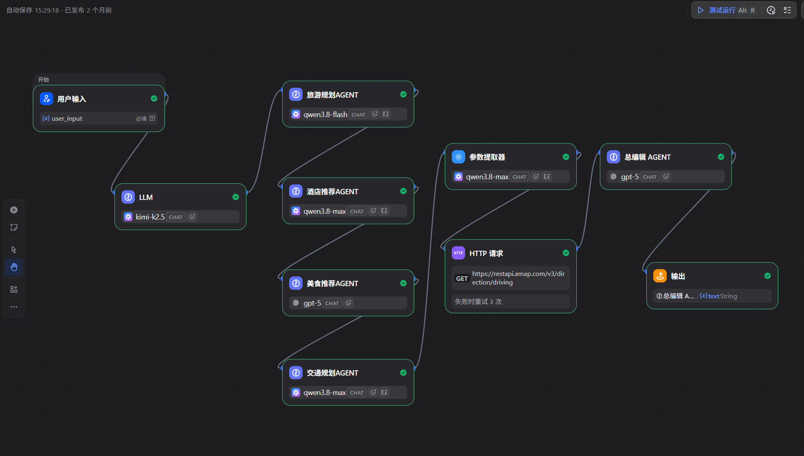

# AI 旅游规划助手

## 一、项目简介

本项目基于 Dify 工作流平台构建，结合大语言模型与高德地图路线 API，尝试实现从用户旅游需求理解、行程规划到交通路线信息整合的 AI 旅游规划流程。

项目通过多个 AI Agent 节点协作，整合旅游规划、酒店推荐、美食推荐、交通规划和结果汇总等功能。

## 二、核心功能

- **旅游规划**：根据用户输入生成旅游规划建议。
- **酒店推荐**：根据旅行需求提供酒店推荐内容。
- **美食推荐**：为旅行计划提供美食建议。
- **交通规划**：规划出行交通，并尝试获取路线信息。
- **路线 API 调用**：通过 HTTP 请求对接高德地图路线接口。
- **结果汇总**：整合相关规划结果，输出最终内容。

具体功能和数据准确性以实际工作流配置及测试结果为准。

## 三、技术栈

| 技术 | 用途 |
|---|---|
| Dify | AI 应用开发与工作流编排 |
| 大语言模型（LLM） | 理解用户需求并生成规划内容 |
| AI Agent | 承担旅游、酒店、美食和交通规划任务 |
| HTTP 请求 | 调用外部路线 API |
| 高德地图开放平台 | 提供路线信息接口 |
| GitHub | 项目配置管理与作品展示 |

## 四、工作流设计

当前工作流包含以下主要模块：

1. 用户输入：接收用户的旅行需求。
2. LLM：处理用户输入，为后续规划提供信息。
3. 旅游规划 Agent：生成旅游规划建议。
4. 酒店推荐 Agent：生成酒店推荐内容。
5. 美食推荐 Agent：生成美食推荐内容。
6. 交通规划 Agent：处理交通规划需求。
7. 参数提取器：提取路线查询所需参数。
8. HTTP 请求：调用高德地图路线接口。
9. 总编排 Agent：汇总相关信息并组织最终答案。
10. 输出节点：返回最终规划结果。

工作流的具体执行顺序和数据传递关系以实际画布配置为准。

## 五、工作流截图

## 六、如何导入和运行

1. 准备可用的 Dify 环境。
2. 从 Dify 导出本应用的 DSL 配置文件。
3. 在目标 Dify 环境中导入 DSL 文件。
4. 检查各个 LLM、Agent、参数提取器和 HTTP 请求节点。
5. 配置所需的模型及高德地图 API 凭证。
6. 使用测试旅行需求运行工作流，核对规划结果与路线信息。

导入 DSL 后可能仍需配置模型、凭证和其他依赖。

## 七、安全说明

- 不要在公开仓库提交真实 API Key、密码或访问令牌。
- 请在 Dify 中单独配置高德地图 API 凭证。
- 对外展示前，检查工作流配置和截图中是否包含敏感信息。
- 路线和旅行建议应以实际查询结果为准。

## 八、后续改进计划

- 增加不同旅行场景的测试用例。
- 优化旅游规划与多 Agent 协作效果。
- 完善路线查询异常处理。
- 记录实际输入、输出和测试结果。
- 持续改进最终行程的清晰度与实用性。

---

本项目用于 Dify 工作流开发学习与作品展示。实际能力取决于模型、提示词、API 配置和工作流实现。
